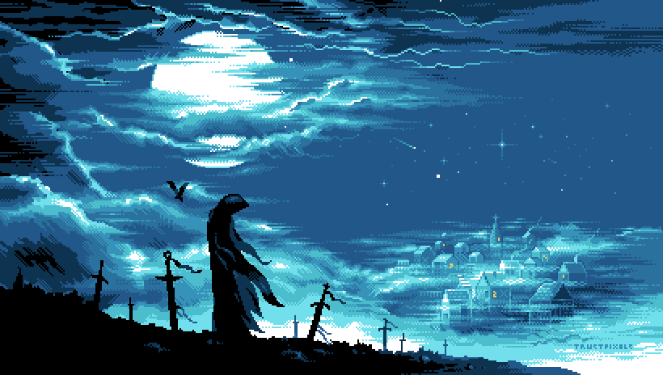

<p align="center">
  
</p>

<h1 align="center">Akbar</h1>

<p align="center">
  <strong>Roblox Luau UI Developer · Web App Developer</strong><br />
  Membangun pustaka antarmuka Roblox dan aplikasi web full-stack yang rapi, cepat, dan enak dipakai.
</p>

<p align="center">
  <a href="https://github.com/Akbar025zzz/kingAkbarUi-Speedhub"></a>
  <a href="https://www.lua.org/"></a>
  <a href="https://www.typescriptlang.org/"></a>
  <a href="https://nextjs.org/"></a>
  <a href="https://nodejs.org/"></a>
  <a href="https://www.postgresql.org/"></a>
  <a href="https://tailwindcss.com/"></a>
  <a href="https://www.docker.com/"></a>
</p>

## Tentang

Saya mengerjakan dua hal yang saling melengkapi: antarmuka di dalam Roblox dengan Luau, dan aplikasi web dengan Next.js serta Node.js. Fokus saya ada di hal yang sering dilewatkan orang lain, yaitu komponen yang perilakunya konsisten, dokumentasi yang bisa langsung dipakai, dan kode yang tetap enak dirawat setelah proyeknya membesar.

Dua proyek di bawah ini saya bangun dari nol, lengkap dengan dokumentasi penggunaan, contoh kode, dan catatan arsitekturnya.

## Proyek pilihan

### [KingAkbarUI Speedhub](https://github.com/Akbar025zzz/kingAkbarUi-Speedhub) — pustaka UI Roblox

Pustaka antarmuka Luau bergaya gelap modern untuk script hub dan tool, nyaman dipakai di PC maupun HP. Versi 1.7 menyertakan 11 komponen siap pakai: Button, Toggle, Slider, Input, Dropdown, Keybind, ColorPicker, Panel, Paragraph, Seperator, dan Line, ditambah kotak pengelompok Section, GroupBox, serta TabBox.

Window-nya menyesuaikan ukuran layar, bisa digeser, dan punya tombol floating serta hotkey untuk tampil atau sembunyi. Tersedia notifikasi, badge topbar, pencarian tab, profil pemain, serta tema dan font yang bisa diganti. Setiap komponen menerima dua gaya penulisan, jadi bisa dipilih sesuai selera, dan pustaka ini aman dijalankan berulang kali karena UI lama dibersihkan otomatis.

```lua
local Lib = loadstring(game:HttpGet(
  "https://raw.githubusercontent.com/Akbar025zzz/kingAkbarUi-Speedhub/refs/heads/main/init.lua"
))()

local Win = Lib:CreateWindow({ "King Akbar", "v1.7", 100, UDim2.fromOffset(420, 280) })
local Tab = Win:CreateTab({ "Main", "rbxassetid://7734010488" })
local Sec = Tab:AddSection("Farm", true)

Sec:AddToggle({ "Auto Farm", "Farm otomatis", false, function(v) print("Farm:", v) end })
Sec:AddSlider({ "WalkSpeed", "", 1, 16, 200, 16, function(v) print("Speed:", v) end })

Lib:SetNotification({ "King Akbar", "Loaded", "Script berhasil dimuat" })
```

<p>
  <a href="https://github.com/Akbar025zzz/kingAkbarUi-Speedhub"></a>
  
  
  
</p>

### [Nobar King Akbar Anime](https://github.com/Akbar025zzz/nobar-king-akbar-anime) — streaming anime dan nonton bareng

Aplikasi web untuk katalog anime sub Indo dan menonton bareng secara realtime. Host mengendalikan pemutaran, semua peserta mengikuti dengan toleransi selisih 1,6 detik, dan obrolan room berjalan langsung dengan riwayat 100 pesan terakhir.

<p align="center">
  <a href="https://github.com/Akbar025zzz/nobar-king-akbar-anime">
    
  </a>
</p>

<p align="center">
  
  
</p>

Selain anime, ada seksi Film dan Series yang mengambil metadata langsung dari TMDb dalam bahasa Indonesia: Film Indonesia, film populer, drakor, dan dracin, lengkap dengan pemilih musim, daftar episode, dan trailer. Pemutarnya memilih server tercepat lewat rantai resolver, memutar HLS dengan hls.js, dan memulihkan error otomatis. Pengguna memiliki akun dengan sesi cookie HttpOnly, token yang di-hash, rate limit anti brute-force, favorit, serta riwayat tontonan yang bisa dilanjutkan dari profil. Seluruh antarmuka berbahasa Indonesia, responsif di ponsel, dan dibungkus Docker.

<p>
  <a href="https://github.com/Akbar025zzz/nobar-king-akbar-anime"></a>
  
  
  
  
</p>

## Aktivitas GitHub

<p align="center">
  <a href="https://github.com/Akbar025zzz">
    
  </a>
</p>

<p align="center">
  
</p>

<p align="center"><sub>Kartu bahasa oleh <a href="https://github.com/anuraghazra/github-readme-stats">github-readme-stats</a>.</sub></p>

<p align="center">
  <a href="https://github.com/Akbar025zzz">
    
  </a>
</p>

<p align="center">
  <picture>
    <source media="(prefers-color-scheme: dark)" srcset="https://raw.githubusercontent.com/Akbar025zzz/Akbar025zzz/output/github-contribution-grid-snake-dark.svg" />
    <source media="(prefers-color-scheme: light)" srcset="https://raw.githubusercontent.com/Akbar025zzz/Akbar025zzz/output/github-contribution-grid-snake.svg" />
    
  </picture>
</p>

---

<p align="center">
  <a href="https://github.com/Akbar025zzz?tab=repositories">Semua repositori</a>
</p>
