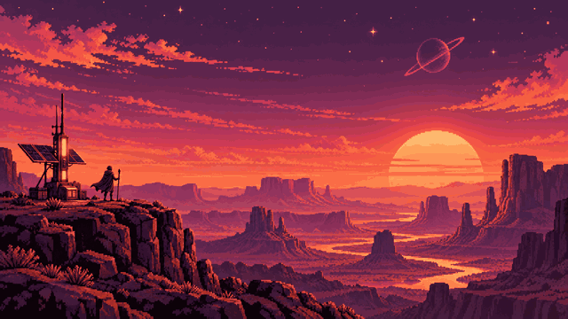

  

## Statistik kontribusi

  

  

## Tech stack

  
  
  

<h1 align="center">Akbar</h1>

  <strong>Roblox UI Developer · Lua/Luau</strong> 
  Membuat pustaka UI Roblox dengan window, tab, dan komponen yang bisa dikonfigurasi.

## Proyek pilihan

### [KingAkbarUi](https://github.com/Akbar025zzz/KingAkbarUi)

Pustaka UI Roblox dengan window, tab, dan 13 elemen antarmuka. Repositori ini menyertakan berkas Lua dan dokumentasi penggunaan.

  

  <a href="https://github.com/Platane/snk">Animasi kontribusi dibuat dengan Platane/snk</a>
  ·
  <a href="https://github.com/Akbar025zzz?tab=repositories">Semua repositori</a>

